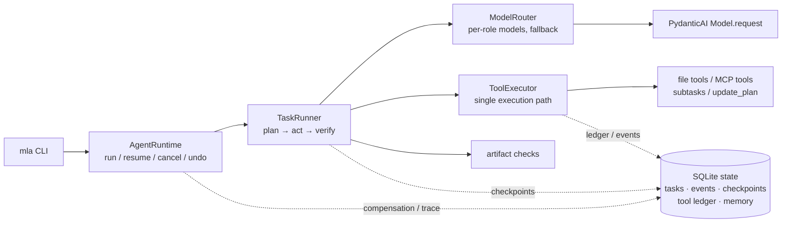

<div align="center">

# Minimal Local Agent

**A stateful agent execution kernel that keeps a ledger, resumes after crashes, and traces every artifact**

[](https://github.com/MuzeAnisichael/minimal-local-agent/actions/workflows/ci.yml)
[](https://github.com/MuzeAnisichael/minimal-local-agent/releases)
[](pyproject.toml)
[](LICENSE)

[简体中文](README.md) · **English**

</div>

Most agent frameworks hand the loop to a single `agent.run()`. Kill the process and the task is gone; run it
again and a file may be written twice; and when something goes wrong, it is hard to tell which step and which
model call produced a given file.

Minimal Local Agent lets **the runtime own the plan → act → verify loop** and persists every step to SQLite:

- 🧾 **Every tool call is ledgered.** Idempotency keys plus a tool ledger: after an interruption the runtime reconciles first, then replays or skips. No double writes, no lost writes.
- ⏯️ **Stop any time, resume any time.** A checkpoint per step; `mla resume` continues from where the process died.
- ↩️ **Automatic compensation.** On failure or cancel, the task's file writes are undone in reverse order. Files changed by someone else are reported as conflicts, never overwritten.
- 🔍 **Traceable artifacts.** `mla trace --artifact FILE` walks from a file back to the tool call, model call and task goal that produced it.
- 📊 **Measured, not claimed.** A per-task-family eval suite with fault injection compares baseline, memory and recovery strategies on success rate and cost.

[PydanticAI](https://ai.pydantic.dev/) is used only as the model-call layer (`Model.request`). Works with local
Ollama or any OpenAI-compatible endpoint (DeepSeek, OpenRouter, …).

> The CLI output, comments and most docs are in Chinese. Command names, config keys and event names are English.

## Quick start

Requires Python 3.11+.

```bash
git clone https://github.com/MuzeAnisichael/minimal-local-agent.git
cd minimal-local-agent
pip install -e ".[dev]"            # add MCP support with ".[dev,mcp]"
```

**1. See the mechanics, no model needed.** A scripted model simulates "process dies right after writing → a new process resumes":

```bash
python examples/offline_demo.py
```

**2. Run the offline eval.** 6 task families, 18 cases, 4 strategies, deterministic (runs in CI):

```bash
mla eval --offline --out eval-report.json
```

**3. Use a real model.** The default config targets local Ollama; API keys are read from environment variables only.

```bash
cp agent.example.toml agent.toml          # edit [models.*] and [routing]
mla run "turn off debug in config.ini" --events
```

`mla run` shows a diff and asks before each write; `--yes` auto-approves. Pass checks as JSON; when they fail, the
task re-runs with the failure reasons:

```bash
echo '[{"type": "file_contains", "path": "config.ini", "text": "debug = false"}]' > checks.json
mla run "turn off debug in config.ini" --checks checks.json --yes
```

## What it looks like

### Crash, resume, trace

From `examples/offline_demo.py`: the process is killed after the write lands but before the ledger marks it done.
On resume the executor reconciles (`tool.reconciled state=after`), sees the file is already written, and records
the call as done without writing again:

```text
#8 step.started  #2
  #9 model.called  act via default in=549 out=24 edit_files
    #10 tool.called  edit_files {"edits": [{"path": "config.ini", ...
    #12 tool.called  edit_files {"edits": [{"path": "config.ini", ...
      #13 tool.reconciled  tool=edit_files state=after
      #14 tool.completed  edit_files done
        #15 artifact.written  config.ini
#11 task.resumed
...
#18 verify.passed  1 checks
#20 task.completed
```

Lineage of an artifact (`mla trace --artifact config.ini`):

```text
#15 artifact.written  config.ini
#14 tool.completed  edit_files done
#12 tool.called  edit_files {"edits": [{"path": "config.ini", ...
#9 model.called  act via default in=549 out=24 edit_files
#8 step.started  #2
#1 task.started  <task goal>
```

### Real-model evaluation (2026-11-19)

Same suite, one fixed model, same budget; 18 cases per strategy, 9 of them with injected faults (crash, timeout,
external edit, invalid tool call).

| Model | Strategy | Success | Fault recovery | Tokens per success |
| --- | --- | ---: | ---: | ---: |
| DeepSeek (deepseek-chat) | baseline | 61% | 33% | 14,748 |
| | memory | 61% | 33% | 15,211 |
| | recovery | **94%** | **100%** | 13,135 |
| | memory + recovery | **94%** | **100%** | **11,866** |
| Qwen3-Coder (OpenRouter) | baseline | 56% | 33% | 21,732 |
| | memory | 50% | 22% | 24,775 |
| | recovery | **83%** | **100%** | **15,140** |
| | memory + recovery | **83%** | 89% | 17,471 |

Recovery accounts for most of the difference and also lowers tokens per successful task; keyword-based episodic
memory is mixed. Methodology, offline numbers and metric definitions: [docs/EVALUATION.md](docs/EVALUATION.md) (Chinese).

## Architecture



Design principles:

1. **The runtime owns the loop.** Plan, act and verify form the runtime's own state machine.
2. **The state store is the single source of truth.** Everything needed to resume lives in SQLite.
3. **One entry point for every tool.** Validation, permissions, approval, budget, timeout, cancellation, retries, ledger and events are implemented once.
4. **Ledger first, then side effect.** Write tools `prepare` a serializable change, which is ledgered before `apply`; recovery and compensation rely only on the ledger.

Details: [docs/ARCHITECTURE.md](docs/ARCHITECTURE.md) (Chinese).

## Features

| Capability | Description |
| --- | --- |
| Planning | Structured plan first; re-run with failure reasons when checks fail (`planning.max_replans`); `update_plan` tool for step status |
| Unified tool protocol | Built-in file tools, MCP tools, subtasks and control tools are all `Tool`s run by one executor |
| Idempotency & recovery | Idempotency key per call; ledger reconciliation after interruption (written / not written / partial / changed externally) |
| Compensation | Reverse-order undo of the task's (and subtasks') file writes on failure or cancel; externally changed files become conflicts |
| Cancel & timeout | Cancellation is stored in the database, so `mla cancel` works across processes; tool timeouts retry |
| Context budget | Token-estimated compaction by whole steps, keeping a summary and the current plan; optional model summaries |
| Call budget | Limits on requests, tool calls, output tokens and cost; subtasks reserve from and settle back to the parent |
| Artifact checks | File equals / contains / absent / sha256, answer contains, command exit code; results are traced too |
| Model switching | A model chain per role (plan / act / summarize) with automatic fallback |
| MCP | Official `mcp` SDK, stdio and Streamable HTTP; allow-listed tools tagged read / write |
| Controlled subtasks | `run_subtask`: own budget, a subset of the parent's tools, cannot spawn further subtasks |
| Event trace | `mla trace` prints the event tree; `--artifact` traces a file back to its origin |
| Evaluation | Task families, fault injection, strategy comparison on success rate, fault recovery and cost per success |

## Commands

| Command | Purpose |
| --- | --- |
| `mla run GOAL [--checks F] [--yes] [--events] [--json]` | Run a task |
| `mla resume TASK_ID` | Resume an interrupted task from its latest checkpoint |
| `mla cancel TASK_ID` | Request cancellation (works across processes); compensates afterwards |
| `mla tasks` / `mla show TASK_ID` | List tasks / show result and tool ledger |
| `mla trace TASK_ID` | Print the event tree |
| `mla trace --artifact PATH` | Trace an artifact back to its origin |
| `mla undo TASK_ID` | Manual compensation: undo the task's file writes |
| `mla eval [--offline] [--model M] [--only F] [--strategies ...] [--no-faults] [--repeat N] [--out F]` | Run the eval suite |

`python -m minimal_local_agent ...` works too. `--config` selects the config file (default `./agent.toml`).

## Configuration

Copy [`agent.example.toml`](agent.example.toml) to `agent.toml` (git-ignored). Every key has a default, unknown keys
are rejected, and relative paths resolve against the config file's directory.

```toml
[models.deepseek]
provider = "openai-compatible"
model = "deepseek-chat"
base_url = "https://api.deepseek.com/v1"
api_key_env = "DEEPSEEK_API_KEY"   # keys come from environment variables only

[routing]                           # per-role model chains; later entries are fallbacks
plan = ["deepseek", "default"]
act = ["deepseek", "default"]
```

All sections: [docs/CONFIGURATION.md](docs/CONFIGURATION.md) (Chinese).

## Project layout

```text
minimal-local-agent/
├── src/minimal_local_agent/
│   ├── core/        I/O-free core: state machine, plan, budget, context compaction
│   ├── runtime/     runtime assembly, tool executor, SQLite store, compensation, trace
│   ├── model/       model adapter and routing (PydanticAI), scripted model
│   ├── tools/       tool protocol, workspace guard, change sets, MCP, subtasks
│   ├── verify/      artifact checks
│   ├── memory/      memory strategies
│   └── eval/        eval runner and fault injection
├── evals/           eval suite (one JSON per task family) and an MCP server for evals
├── examples/        demos that run without a model
├── tests/           unit and regression tests
└── docs/            architecture, evaluation, configuration, release notes
```

2.0 is a breaking rewrite. The 1.x code is kept at tag [`v1.1-archive`](https://github.com/MuzeAnisichael/minimal-local-agent/tree/v1.1-archive).

## Contributing

```bash
pip install -e ".[dev,mcp]"
ruff format --check . && ruff check .
pytest
```

See [CONTRIBUTING.md](CONTRIBUTING.md). Report vulnerabilities privately as described in [SECURITY.md](SECURITY.md).

## License

[MIT](LICENSE)
