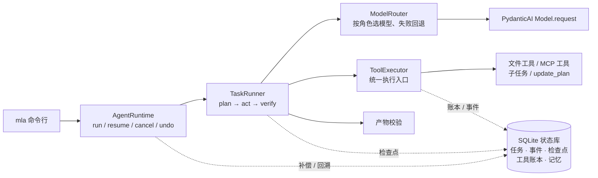

<div align="center">

# Minimal Local Agent

**会记账、能续跑、可回溯的有状态 Agent 执行内核**

[](https://github.com/MuzeAnisichael/minimal-local-agent/actions/workflows/ci.yml)
[](https://github.com/MuzeAnisichael/minimal-local-agent/releases)
[](pyproject.toml)
[](LICENSE)

**简体中文** · [English](README.en.md)

</div>

大多数 Agent 框架把“循环”交给一次 `agent.run()`：进程一断，任务就丢；重跑一遍，文件可能被写两次；
出了错，也很难说清楚某个文件到底是哪一步、哪次模型调用写出来的。

Minimal Local Agent 让**运行时自己掌握“规划 → 执行 → 校验”循环**，并把每一步落到 SQLite 状态库：

- 🧾 **每次工具调用都记账**：幂等键 + 工具账本，中断后先对账再决定重放还是跳过，不重复写、不丢写。
- ⏯️ **随时中断，随时续跑**：每一步写检查点，进程被杀后 `mla resume` 从断点继续。
- ↩️ **失败自动补偿**：失败或取消时逆序撤销本任务写过的文件；被别人改过的文件只报冲突，不覆盖。
- 🔍 **产物可回溯**：`mla trace --artifact 文件` 从产物一路追到工具调用、模型调用和任务目标。
- 📊 **用评测说话**：按任务族的评测集 + 故障注入，对比基础循环、记忆、恢复策略的成功率和成本。

模型调用层使用 [PydanticAI](https://ai.pydantic.dev/)（只用 `Model.request`），可以接本地 Ollama 或任何 OpenAI 兼容接口（DeepSeek、OpenRouter 等）。

## 目录

- [快速开始](#快速开始)
- [效果](#效果)
- [架构](#架构)
- [功能](#功能)
- [命令](#命令)
- [配置](#配置)
- [项目结构](#项目结构)
- [文档](#文档)
- [参与开发](#参与开发)

## 快速开始

需要 Python 3.11+。

```bash
git clone https://github.com/MuzeAnisichael/minimal-local-agent.git
cd minimal-local-agent
pip install -e ".[dev]"            # 需要 MCP 时用 ".[dev,mcp]"
```

**1. 不需要模型，先看机制。** 下面的演示用脚本模型模拟“写盘后进程崩溃 → 新进程续跑”，几秒内跑完：

```bash
python examples/offline_demo.py
```

**2. 跑一遍离线评测。** 6 个任务族、18 个用例、4 种策略，结果是确定的（CI 每次都跑）：

```bash
mla eval --offline --out eval-report.json
```

**3. 接上真实模型。** 默认配置是本地 Ollama；远程模型的密钥只从环境变量读取。

```bash
cp agent.example.toml agent.toml          # 按需修改 [models.*] 和 [routing]
mla run "把 config.ini 里的 debug 关掉" --events
```

`mla run` 在每次写文件前显示 diff 并询问，`--yes` 自动批准。校验规则可以写成 JSON 传入，校验不通过时会带着失败原因重新执行：

```bash
echo '[{"type": "file_contains", "path": "config.ini", "text": "debug = false"}]' > checks.json
mla run "把 config.ini 里的 debug 关掉" --checks checks.json --yes
```

## 效果

### 崩溃续跑与回溯

`examples/offline_demo.py` 的输出节选。写盘之后、账本标记完成之前进程被杀；新进程续跑时，
执行入口通过对账（`tool.reconciled state=after`）确认文件已写入，于是直接记为完成，不再写第二次：

```text
#8 step.started  #2
  #9 model.called  act via default in=549 out=24 edit_files
    #10 tool.called  edit_files {"edits": [{"path": "config.ini", ...
    #12 tool.called  edit_files {"edits": [{"path": "config.ini", ...
      #13 tool.reconciled  tool=edit_files state=after
      #14 tool.completed  edit_files done
        #15 artifact.written  config.ini
#11 task.resumed
...
#18 verify.passed  1 checks
#20 task.completed
```

从产物反查来源（`mla trace --artifact config.ini`）：

```text
#15 artifact.written  config.ini
#14 tool.completed  edit_files done
#12 tool.called  edit_files {"edits": [{"path": "config.ini", ...
#9 model.called  act via default in=549 out=24 edit_files
#8 step.started  #2
#1 task.started  把 config.ini 里的 debug 关掉
```

### 真实模型评测（2026-11-19）

同一评测集，每个模型固定一个、预算相同；每种策略 18 个用例，其中 9 个注入故障（崩溃、超时、外部改动、非法调用）。

| 模型 | 策略 | 成功率 | 故障恢复率 | 每成功任务 tokens |
| --- | --- | ---: | ---: | ---: |
| DeepSeek（deepseek-chat） | 基础循环 | 61% | 33% | 14,748 |
| | 记忆 | 61% | 33% | 15,211 |
| | 恢复 | **94%** | **100%** | 13,135 |
| | 记忆+恢复 | **94%** | **100%** | **11,866** |
| Qwen3-Coder（OpenRouter） | 基础循环 | 56% | 33% | 21,732 |
| | 记忆 | 50% | 22% | 24,775 |
| | 恢复 | **83%** | **100%** | **15,140** |
| | 记忆+恢复 | **83%** | 89% | 17,471 |

恢复机制是成功率差异的主要来源，还顺带降低了每成功任务的 token 消耗；关键词检索式的记忆效果不稳定。
评测方法、离线结果和指标定义见 [docs/EVALUATION.md](docs/EVALUATION.md)。

## 架构



四条设计原则：

1. **运行时掌握循环**：规划、执行、校验是运行时自己的状态机，不交给框架的 Agent 循环。
2. **状态库是唯一事实来源**：恢复所需的一切都在 SQLite 里，进程里不保存状态库之外的必要状态。
3. **所有工具走同一个入口**：参数校验、权限、审批、预算、超时、取消、重试、账本、事件只实现一次。
4. **副作用先落账，再落地**：写工具先 `prepare` 出可序列化的变更，写进账本后再 `apply`；恢复和补偿只依赖账本。

详见 [docs/ARCHITECTURE.md](docs/ARCHITECTURE.md)。

## 功能

| 能力 | 说明 |
| --- | --- |
| 任务规划 | 先生成结构化计划；校验失败时带着失败原因重新执行（`planning.max_replans`）；模型可用 `update_plan` 更新步骤状态 |
| 统一工具协议 | 内置文件工具、MCP 工具、子任务、控制工具都是同一个 `Tool`，经同一个执行入口 |
| 幂等与恢复 | 每次工具调用有幂等键；中断后按账本对账（已写入 / 未写入 / 部分写入 / 被外部改动） |
| 补偿 | 失败或取消时逆序撤销本任务（含子任务）的文件写入；被改过的文件记为冲突 |
| 取消与超时 | 取消信号写进状态库，`mla cancel` 对另一个进程里的任务也有效；工具超时可自动重试 |
| 上下文预算 | 按 token 估算裁剪历史，以“步骤”为单位丢弃，保留摘要和当前计划；可选用模型做摘要 |
| 调用预算 | 请求数、工具调用数、输出 token、成本四项上限；子任务从父任务预留额度，用完结算 |
| 产物校验 | 文件内容、包含、缺失、哈希、回答包含、命令退出码；校验结果也记入事件轨迹 |
| 模型切换 | 按角色（plan / act / summarize）配置模型链，前一个失败自动换下一个 |
| MCP 接入 | 官方 `mcp` SDK，支持 stdio 和 Streamable HTTP；只暴露白名单工具，并标注读 / 写 |
| 受控子任务 | `run_subtask`：独立预算，工具只能是父任务可见工具的子集，不能再派生子任务 |
| 事件轨迹 | `mla trace` 打印事件树，`--artifact` 从产物回溯到工具调用、模型调用、步骤和任务输入 |
| 评测 | 按任务族划分，可注入故障，对比策略的成功率、故障恢复率和每成功任务成本 |

## 命令

| 命令 | 作用 |
| --- | --- |
| `mla run GOAL [--checks F] [--yes] [--events] [--json]` | 执行一个任务 |
| `mla resume TASK_ID` | 从最近的检查点继续一个中断的任务 |
| `mla cancel TASK_ID` | 请求取消（对另一个进程中的任务也有效），取消后自动补偿 |
| `mla tasks` / `mla show TASK_ID` | 列出任务 / 查看结果和工具账本 |
| `mla trace TASK_ID` | 打印事件树 |
| `mla trace --artifact PATH` | 从产物回溯完整来源链 |
| `mla undo TASK_ID` | 手动补偿：撤销任务写入的文件 |
| `mla eval [--offline] [--model M] [--only F] [--strategies ...] [--no-faults] [--repeat N] [--out F]` | 运行评测 |

也可以用 `python -m minimal_local_agent ...`。全局参数 `--config` 指定配置文件，默认 `./agent.toml`。

## 配置

复制 [`agent.example.toml`](agent.example.toml) 为 `agent.toml`（已被 Git 忽略）。所有配置项都有默认值，未知字段会报错；
相对路径按配置文件所在目录解析。

```toml
[models.deepseek]
provider = "openai-compatible"
model = "deepseek-chat"
base_url = "https://api.deepseek.com/v1"
api_key_env = "DEEPSEEK_API_KEY"   # 密钥只从环境变量读取

[routing]                           # 按角色选模型，靠后的是失败回退
plan = ["deepseek", "default"]
act = ["deepseek", "default"]
```

每个配置段的含义见 [docs/CONFIGURATION.md](docs/CONFIGURATION.md)。

## 项目结构

```text
minimal-local-agent/
├── src/minimal_local_agent/
│   ├── core/        与 I/O 无关的核心：状态机、计划、预算、上下文压缩
│   ├── runtime/     运行时：组装、统一执行入口、状态库、补偿、事件回溯
│   ├── model/       模型适配与路由（PydanticAI）、脚本模型
│   ├── tools/       工具协议、工作区防护、文件变更集、MCP、子任务
│   ├── verify/      产物校验
│   ├── memory/      记忆策略
│   └── eval/        评测运行器与故障注入
├── evals/           评测集（每个任务族一个 JSON）与评测用 MCP 服务器
├── examples/        无需模型即可运行的演示
├── tests/           单元与回归测试
└── docs/            架构、评测、配置文档与发布说明
```

## 文档

- [架构说明](docs/ARCHITECTURE.md)：模块划分、任务状态机、账本与恢复、事件模型
- [评测](docs/EVALUATION.md)：任务族、故障注入、策略、指标与结果
- [配置](docs/CONFIGURATION.md)：每个配置段的含义和默认值
- [更新日志](CHANGELOG.md) · [发布说明](docs/releases/) · [安全说明](SECURITY.md)

> 2.0 是一次不兼容的重写。1.x 的代码保存在 [`v1.1-archive`](https://github.com/MuzeAnisichael/minimal-local-agent/tree/v1.1-archive) 标签。

## 参与开发

```bash
pip install -e ".[dev,mcp]"
ruff format --check . && ruff check .
pytest
```

提交前请阅读 [CONTRIBUTING.md](CONTRIBUTING.md)。漏洞请通过 GitHub 私密漏洞报告提交，见 [SECURITY.md](SECURITY.md)。

## 许可证

[MIT](LICENSE)
